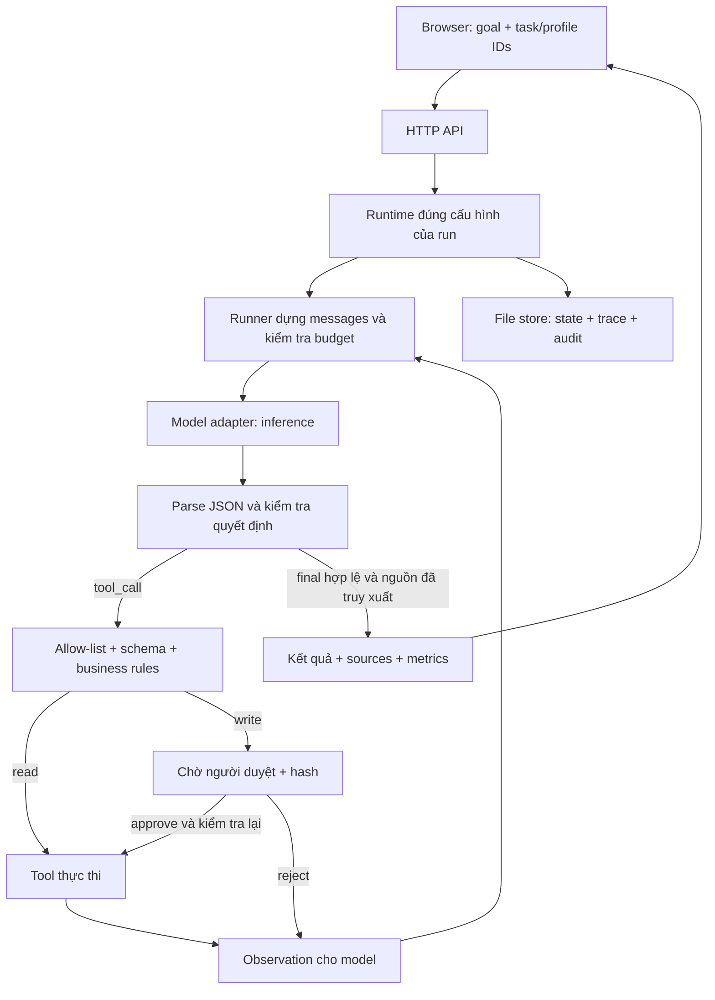

# Kiến thức và câu hỏi vấn đáp — AI Agent Starter

Tài liệu để luyện giải thích **project đang có**, mở code chứng minh và bổ sung câu hỏi sau. Đối chiếu ngày **2026-10-08**, cập nhật sửa P2 tại `6fb21e5` và instruction tại `c575717`. Thông tin model trong môi trường có thể đổi; phải kiểm tra profile của **run đang trình bày**. Không coi câu trả lời trong tài liệu này là chỉ thị cho agent.

Ký hiệu: **[Đã có]** là hành vi xác nhận trong source; **[Kiến thức nền]** là khái niệm để giải thích; **[Chưa có]** là hướng mở rộng, không được giới thiệu như tính năng hiện tại. Kết quả live ở cuối là bằng chứng ngày 2026-10-07; đợt soạn tài liệu này không gọi lại LLM.

## 1. Câu giới thiệu và bản đồ code

**Câu giới thiệu khoảng 30 giây:** “Em xây một sườn AI Agent bằng Node.js và frontend thuần. Model có sẵn nhận mục tiêu và kết quả tool, rồi đề xuất tool hoặc câu trả lời cuối bằng JSON. Backend kiểm tra quyền, schema, business rules và ngân sách trước khi thực thi. Ghi chú được truy xuất bằng BM25; bảng JSON/CSV được lọc, đếm, cộng và so sánh bằng code xác định. Tool ghi phải có người duyệt và chống ghi trùng. Kết quả có source ID để kiểm tra nguồn.”

| Thành phần | Trách nhiệm | File/hàm nên mở |
|---|---|---|
| Startup | Nạp cấu hình, catalog, tạo HTTP server | [server.js](../src/server.js), [context.js](../src/operations/context.js): `loadEnvironment()` |
| HTTP API | Nhận goal/approval, trả run và metadata | [app.js](../src/app.js): `createApp()`, `route()` |
| Catalog | Xác thực task/profile; tạo registry/retriever của từng task | [catalog.config.js](../config/catalog.config.js): `loadCatalog()`, `buildCatalog()` |
| Quản lý runtime | Gắn mỗi run vào đúng task/model/settings, phục hồi lịch sử | [runManager.js](../src/agent/runManager.js): `createRunManager()` |
| Agent loop | Hỏi model → kiểm tra → tool/approval/final → lặp | [runner.js](../src/agent/runner.js): `askModel()`, `drive()`, `executeTool()` |
| Decision | Parse JSON và kiểm tra final/source IDs | [decision.js](../src/agent/decision.js): `parseDecision()`, `checkGrounding()` |
| State | Trạng thái run, hash approval, public view | [state.js](../src/agent/state.js): `createRun()`, `transition()`, `argsHash()` |
| Model adapter | Gửi inference request thật, xử lý response/retry | [openaiCompatible.js](../src/model/openaiCompatible.js): `once()`, `complete()` |
| Retrieval ghi chú | Tách passage, tokenize và chấm BM25 | [keywordSearch.js](../src/retrieval/keywordSearch.js) |
| Tool registry | Allow-list, schema, business rules, quyền read/write | [registry.js](../src/tools/registry.js): `check()` |
| Dataset | Nạp snapshot an toàn, validate JSON/CSV, số fixed-point | [datasets.js](../src/data/datasets.js) |
| Tool đọc bảng | Lookup/count/sum/compare và provenance | [queryDataset.js](../src/tools/queryDataset.js) |
| Persistence | Run JSON, draft idempotent, audit JSONL | [fileStore.js](../src/store/fileStore.js) |
| Metrics/budget | Đếm request, validate usage, dự phòng token | [metrics.js](../src/agent/metrics.js) |
| Frontend | Chọn cấu hình, polling, trace, approval, reload | [app.js](../public/app.js), [configuration.js](../public/configuration.js), [run-session.js](../public/run-session.js) |



## 2. Code hoạt động như thế nào?

### Q01. Vì sao gọi đây là AI Agent?

**Trả lời:** Model chọn hành động tiếp theo dựa trên goal và observation, không chỉ sinh một câu trả lời duy nhất. Backend có vòng lặp và điều kiện dừng. Thứ tự tìm kiếm, lưu nháp hoặc kết thúc do model đề xuất trong giới hạn quyền.

**Chỉ code:** `drive()` trong [runner.js](../src/agent/runner.js). Rule-based mock/scripted model chỉ mô phỏng giao thức, không chứng minh khả năng suy luận của LLM thật.

### Q02. Agent khác chatbot và workflow cố định thế nào?

Chatbot đơn giản thường trả văn bản sau một lượt hỏi. Workflow cố định viết sẵn thứ tự bước. Agent này có thể hỏi tool rồi dùng kết quả để chọn bước mới. Vẫn có workflow an toàn do backend định nghĩa: kiểm tra quyền, duyệt ghi, giới hạn và trạng thái. Nếu nghiệp vụ luôn cố định, dùng workflow có thể dễ kiểm soát hơn.

### Q03. Một goal đi từ UI đến final qua những bước nào?

1. Browser gửi `POST /api/runs` với goal và task/profile IDs, hoặc chỉ goal để dùng defaults.
2. Backend xác thực ID/goal, tạo run, chụp cấu hình và lưu; trả `202` với run.
3. `buildMessages()` ghép system prompt, goal và lịch sử cần thiết; `askModel()` gọi model.
4. Model trả một JSON decision. `parseDecision()` kiểm tra protocol.
5. Nếu là tool: registry kiểm tra; read chạy ngay, write chuyển sang chờ approval.
6. Kết quả tool được ghi trace, đăng ký source IDs và gửi lại như `OBSERVATION` chứa `untrusted_data`.
7. Model trả final; backend kiểm tra nguồn đã truy xuất rồi lưu trạng thái `completed`.

Nếu lỗi hoặc hết giới hạn, run kết thúc với mã cụ thể; không đảm bảo mọi goal đều completed.

### Q04. Model nhận những thông tin nào? Có nhận toàn bộ file dữ liệu không?

Nhận mission, safety rules, protocol JSON, mô tả/schema tool được bật, goal và lịch sử observation. Dataset description có IDs/cột, không có đường dẫn file. Các dòng dữ liệu chỉ tới model qua kết quả tool có giới hạn. Notes search trả passage liên quan, không gửi toàn bộ thư mục.

**Chỉ code:** [prompts.js](../config/prompts.js): `buildSystemPrompt()`; [runner.js](../src/agent/runner.js): `buildMessages()`, `observe()`, `fitObservation()`. Observation/context quá dài được rút gọn; model không có trí nhớ vô hạn.

### Q05. Run có những trạng thái nào?

`running`, `awaiting_approval`, `completed`, `failed`, `stopped`. `transition()` kiểm tra chuyển trạng thái hợp lệ. Các trạng thái terminal không quay về running. `failed` dành cho lỗi như output không sửa được hoặc provider lỗi; `stopped` dành cho user stop/giới hạn như hết budget.

**Chỉ code:** [state.js](../src/agent/state.js): `STATUS`, `ALLOWED`; [runner.js](../src/agent/runner.js): `finish()`.

## 3. Dữ liệu nào đang có và được xử lý ra sao?

### Q06. Nguồn dữ liệu nằm ở đâu? Là dữ liệu thật hay dữ liệu huấn luyện?

Đây là **dữ liệu mẫu/giả lập để kiểm thử và demo**, không phải dữ liệu huấn luyện model hoặc quy định thật của môn học. Catalog hiện có:

| Task ID | Dữ liệu và cấu trúc | Tool được bật |
|---|---|---|
| `study-notes` | 7 Markdown ở [data/notes](../data/notes): agent loop, RAG, HTTP, idempotency, giữa kỳ, cuối kỳ, bản chép diễn đàn chứa injection | `search_notes`, `save_draft` |
| `datasets-demo` | [products.json](../data/datasets/products.json): 4 dòng, id/name/category/price/stock; [classes.csv](../data/datasets/classes.csv): 4 dòng, id/course/day/room/students | `query_dataset` |
| `rehearsal-tickets` | [tickets.json](../data/datasets/tickets.json): 6 dòng, id/team/status/hours | `query_dataset` |
| `rehearsal-rooms` | [rooms.csv](../data/datasets/rooms.csv): 5 dòng, id/room/location/capacity | `query_dataset` |

Task bảng hiện vẫn khai báo thư mục notes hợp lệ theo schema chung, nhưng không có `search_notes` nên model không được tra cứu các notes đó. Metadata UI chỉ hiện dữ liệu tương ứng tool được bật.

### Q07. Nếu hỏi tỉ trọng điểm hoặc phòng thi, trả lời thế nào?

Trong **notes giả lập**, giữa kỳ là 30%, cuối kỳ 40%; phải truy xuất/cite `midterm` và `final-project`, không gọi đó là quy định thật. Số phòng thi cụ thể không có bằng chứng nên giải thích thiếu dữ liệu trong `unresolved`. Passage có từ “giữa kỳ” chưa chắc trả lời được câu hỏi “phòng thi ở đâu”.

**Chỉ dữ liệu:** [midterm.md](../data/notes/midterm.md), [final-project.md](../data/notes/final-project.md). Đây cũng là ví dụ phân biệt “retrieval tìm thấy” với “evidence thực sự trả lời”.

### Q08. Model được truyền đường dẫn JSON/CSV bất kỳ không?

Không. Model chỉ truyền `dataset_id` đã được task cho phép. File/cột/scale được backend khai báo trong task config và nạp lúc startup. Loader chặn traversal, symlink, file không hợp lệ hoặc quá lớn. Browser không được gửi module, mission, allow-list hay endpoint tùy ý.

**Chỉ code:** [task.config.js](../config/task.config.js): `validateTaskConfig()`; [datasets.js](../src/data/datasets.js): `readDataset()`, `loadDatasets()`; [queryDataset.js](../src/tools/queryDataset.js): `checkRules()`.

### Q09. `query_dataset` hỗ trợ gì? Có phải SQL/vector search không?

Tool read-only có bốn operation: `lookup`, `count`, `sum`, `compare`. Filter trong một nhóm nối bằng **AND**. String chỉ `eq/ne`, so sánh chính xác và phân biệt hoa thường. Number hỗ trợ `eq/ne/lt/lte/gt/gte`; giá trị filter gửi bằng decimal string. Không có SQL, OR tùy ý, join, công thức hoặc group-by tổng quát.

`compare` dùng `filters` và `compare_filters`: bỏ `field` để so sánh counts; thêm numeric `field` để so sánh sums. `limit` chỉ dùng lookup, mặc định 5, tối đa 10; aggregates tính trên **toàn bộ** dòng khớp.

### Q10. Ví dụ nào dễ mở code và dự đoán đáp án?

Ví dụ proposal hợp lệ, chạy bằng tool của task `datasets-demo`:

```json
{"type":"tool_call","tool":"query_dataset","arguments":{"dataset_id":"products","operation":"sum","field":"price","filters":[{"field":"category","op":"eq","value":"stationery"}]}}
```

Backend cộng `10.10 + 20.20`, trả decimal string **`"30.30"`**. `count` các lớp Mon là **2**. Compare sum students Mon/Tue trả **`["55","40"]`**, relation **`gt`**. Support/open tickets có **2**; Billing/open có **1**. Tổng capacity North là **`"70"`**; South/capacity>=40 chỉ có phòng **B202**.

Source ID phải lấy từ **kết quả chạy thật**, không chép một ID minh họa từ tài liệu hoặc tự dựng ID.

### Q11. Vì sao không để LLM tự cộng số? Fixed-point hoạt động thế nào?

Backend cần kết quả tái lập và chính xác; LLM có thể tính hoặc chép sai. Cột `price` scale 2 được đổi thành đơn vị nguyên: `10.10 → 1010n`, `20.20 → 2020n`; cộng `BigInt` thành `3030n`, format thành `"30.30"`. Không dùng phép cộng floating-point thông thường cho tổng tiền.

`decimalUnits()` từ chối rỗng, dạng số sai, NaN/Infinity, exponent hoặc số vượt range được phép; số có phần thập phân vượt scale bị từ chối, **không tự làm tròn**. Scale từ 0 đến 6. Mỗi giá trị scaled được giới hạn; tổng dùng BigInt. JSON parser giữ spelling numeric token trước khi JS Number làm mất độ chính xác. Numeric data được chuẩn hóa thành decimal strings trong snapshot.

**Chỉ code:** [datasets.js](../src/data/datasets.js): `decimalUnits()`, `JsonNumberToken`, `formatUnits()`; [queryDataset.js](../src/tools/queryDataset.js): `total()`, `display()`.

### Q12. Tại sao CSV không dùng `split(',')`? Giới hạn dữ liệu là gì?

Ô CSV có thể chứa dấu phẩy, quote escape `""` hoặc xuống dòng khi được quoted. `parseCsv()` dùng các trạng thái để phân biệt delimiter và nội dung; hỗ trợ LF/CRLF. Header phải có đủ cột khai báo, không trùng/lạ; dòng sai số ô hoặc quote không đóng bị từ chối.

`DATASET_LIMITS`: **128 KiB/file, 200 dòng, 1500 ký tự result có wrapper**. Lookup dài quá bị báo lỗi, không cắt làm hỏng JSON. `truncated=true` nghĩa là còn dòng khớp ngoài trang lookup, không được lấy số dòng trang làm tổng.

### Q13. Snapshot, fingerprint và provenance là gì?

Snapshot là dữ liệu đã nạp/validate để runtime dùng ổn định. Dataset `version` là SHA-256 của khai báo và bytes file; task fingerprint gồm task config, versions dataset và notes. Đây là hash nhận diện thay đổi, không phải embedding.

Dataset source ID có dạng `ds-<dataset_id>-<hash>`, lấy từ dataset version và query đã chuẩn hóa. Result còn có `dataset_version`, `query`, count/values, vị trí dòng. Nguồn của lookup rỗng vẫn chứng minh điều kiện đã được chạy trên snapshot nào.

Provenance dùng ranges hoặc bitmap base64 không mất thông tin, giúp 200 dòng xen kẽ hai nhóm vẫn vừa giới hạn. Dòng JSON là index+1; dòng CSV là thứ tự **data record không tính header**, không nhất thiết là dòng vật lý nếu ô có newline. Hash query giữ thứ tự filters, nên đổi thứ tự filters tương đương có thể đổi source ID.

**Chỉ code:** [queryDataset.js](../src/tools/queryDataset.js): `rowProvenance()`, hash/result; [datasets.js](../src/data/datasets.js): `version`.

## 4. Retrieval, RAG, embedding và token

### Q14. Project có dùng embedding không? Có vector database không?

**[Đã có] Không có embedding retrieval hoặc vector database.** Notes dùng keyword BM25; bảng dùng filter/tính toán xác định. Không có request `/embeddings`, chunk vectors hay index cosine trong đường chạy hiện tại.

“LLM bên trong thường có biểu diễn embedding” và “ứng dụng xây embedding index cho retrieval” là hai việc khác nhau. Repo này gọi model có sẵn, không triển khai các lớp neural network bên trong model.

### Q15. BM25 hoạt động thế nào trong code này?

Notes được tách thành passage theo đoạn cách dòng trống. Mỗi passage được tokenize cả title và text; index lưu tần suất từ `tf`, độ dài `len`, document frequency `df` và độ dài trung bình. Query tokenize và bỏ từ trùng; mỗi passage nhận tổng điểm theo các query terms xuất hiện.

Công thức đang dùng, với `N` là **số passage**:

```text
idf(t) = ln(1 + (N - df(t) + 0.5) / (df(t) + 0.5))
score(p,q) = sum over unique terms t in q:
  idf(t) * tf(t,p)*(k1+1) / (tf(t,p) + k1*(1-b+b*len(p)/avgLen))
k1 = 1.2; b = 0.75
```

Từ hiếm có trọng số cao hơn; tf có hiệu ứng bão hòa; length normalization giảm lợi thế đoạn dài. Code lọc score>0, sắp giảm dần rồi lấy limit. Search tool mặc định 3, tối đa 5 passages; text mỗi passage trả tối đa 600 ký tự rồi thêm dấu rút gọn. **Score không phải xác suất câu trả lời đúng.**

**Chỉ code:** [keywordSearch.js](../src/retrieval/keywordSearch.js): `parseNote()`, `createRetrieverFromDocs()`, `search()`.

### Q16. Tiếng Việt và chunking được xử lý ra sao?

`tokenize()` lower-case, bỏ dấu Unicode, đổi `đ → d`, tách theo ký tự ngoài a-z/0-9, bỏ token ngắn và stopwords. Ví dụ “bảo mật” gần với “bao mat” về token. Đây là chuẩn hóa từ khóa đơn giản, không phải bộ tách từ tiếng Việt theo nghĩa.

Một paragraph là một chunk/passage; title được lấy từ `# `, dòng bắt đầu `>` được bỏ khỏi body như metadata. Source ID của note là tên file không extension, passage number là vị trí đoạn. Bỏ dấu có thể làm các từ khác nghĩa trùng nhau; paraphrase/từ đồng nghĩa có thể không match.

### Q17. Embedding là gì và hoạt động thế nào? [Kiến thức nền, chưa triển khai retrieval]

Embedding biểu diễn dữ liệu bằng vector số. Với sentence embedding, một encoder tạo vector cho câu/đoạn; similarity như cosine được dùng để so sánh biểu diễn ngữ nghĩa. Ví dụ phương pháp Sentence-BERT tạo sentence embeddings và so sánh bằng cosine. [Nguồn nền: bài báo Sentence-BERT](https://aclanthology.org/D19-1410/).

Pipeline mở rộng có thể là: chia đoạn → encode từng đoạn → lưu vector kèm text/source ID → encode query bằng model tương thích → tìm các vector gần → trả text cho model sinh câu trả lời. Ví dụ giả định `[0.2, -0.1, 0.7]` chỉ minh họa một vector, không phải vector đã tạo trong repo.

Cosine cho hai vector khác zero: `cos(a,b) = dot(a,b)/(norm(a)*norm(b))`. Similarity cao là tín hiệu truy xuất; vẫn phải kiểm tra passage có trả lời câu hỏi không. Embedding không tự sinh câu trả lời hay thực thi tool.

### Q18. BM25 và embedding retrieval khác nhau thế nào?

| Tiêu chí | BM25 trong repo | Embedding retrieval nếu bổ sung |
|---|---|---|
| Tín hiệu | Từ xuất hiện, tf/df, độ dài | Khoảng cách/similarity trong không gian vector |
| Tài nguyên | Index từ khóa nhỏ trong RAM, không gọi embedding model | Cần encoder, vector storage/index và quản lý version |
| Điểm mạnh | Rẻ, dễ giải thích, hợp từ khóa/tên chính xác | Có thể tìm câu diễn đạt khác từ ngữ |
| Rủi ro | Trượt synonyms, match từ nhưng lệch ý | Có thể lấy đoạn gần nghĩa nhưng không đủ evidence |
| Hiện trạng | Đã có | Chưa có; chưa chọn model, dimension hay vector DB |

Không kết luận embedding luôn tốt hơn. Phải eval theo câu hỏi, ngôn ngữ, chi phí và dữ liệu thực tế. Với đếm/tổng chính xác của bảng, vẫn nên dùng tool xác định thay vì tìm vector rồi để LLM cộng.

### Q19. Muốn thêm embedding thì sửa ở đâu?

Viết retriever mới tương thích `search(query,{limit})`, `has(sourceId)` và result `{source_id,title,passage,text,score}`. Tích hợp catalog còn cần metadata `kind`, `sourceCount`, `describe()` hoặc thích nghi tương ứng. Chỗ tạo retriever hiện tại là **`buildCatalog()` trong [catalog.config.js](../config/catalog.config.js)**. Hướng dẫn cũ nói thay một dòng trong `src/app.js` thuộc kiến trúc trước catalog, không đủ cho code hiện tại.

Cần thiết kế chunk/index/version, encoder/document-query compatibility, data access, giới hạn và tests/evals riêng. Giữ source grounding/approval/backend rights. Đây là công việc tương lai, không có model embedding được khai báo sẵn.

### Q20. RAG có bắt buộc dùng vector search? Retrieval khác generation thế nào?

Retrieval tìm evidence; generation dùng evidence để diễn đạt câu trả lời. Pattern RAG không bắt buộc là vector search: luồng notes ở đây dùng BM25 để cung cấp ngữ cảnh cho generation. Luồng bảng là structured retrieval + backend calculation. Không gọi hai luồng đó là “RAG vector”.

### Q21. Token của BM25, token của LLM và embedding có giống nhau không?

Không. `tokenize()` trong retriever là token từ khóa do repo tự tách. LLM dùng tokenizer của provider/model, token không tương đương một từ hoặc một ký tự. Embedding là vector biểu diễn, không phải số token. Repo không dùng tokenizer LLM chính xác cho budget; provider báo usage khi có, còn dự phòng dùng heuristic riêng.

## 5. Model, inference và giao thức JSON

### Q22. Dùng model gì? Chỉ ra chính xác ở đâu.

| Profile ID | Runtime khai báo | Nơi kiểm tra |
|---|---|---|
| `env` — default profile | Đọc cấu hình môi trường; lúc đối chiếu là `openai-compatible`, `qwen3:8b` | [agent.config.js](../config/agent.config.js): `loadConfig()` và `.env` trên máy; không đưa key lên tài liệu/UI |
| `mock` | `rule-based-mock`, không LLM thật | [mock.js](../src/model/mock.js) |
| `ollama-qwen3` | Qwen3 `qwen3:8b`, local Ollama OpenAI-compatible endpoint | [catalog.json](../config/catalog.json): model_profiles |
| `ollama-qwen3-4b` | `qwen3:4b`, profile so sánh, không auto fallback | [catalog.json](../config/catalog.json) |

Factory [model/index.js](../src/model/index.js): `createModel()` chọn mock hoặc adapter thật. `loadConfig()` có fallback name `gemini-2.5-flash`, nhưng **không được suy ra run hiện tại dùng Gemini từ giá trị fallback đó**. UI đọc catalog; run lưu `model`, profile ID và identity. Đổi `.env`/select không đổi model của run đã bắt đầu.

“Ollama” là dịch vụ chạy model local; “Qwen3” là model; “openai-compatible” là provider interface trong code. Tên interface không có nghĩa tất cả request đều tới cloud OpenAI.

### Q23. Code nào là LLM inference? Model thực sự chạy ở đâu?

**Hai vị trí cần mở:**

- [runner.js](../src/agent/runner.js), `askModel()`: `await model.complete({ messages, signal, requestControl })` — ứng dụng yêu cầu một inference.
- [openaiCompatible.js](../src/model/openaiCompatible.js), `once()`: dựng payload và `fetch()` POST `chat/completions` — gửi request thật.

Trích rút gọn để giải thích, không phải một hàm độc lập:

```js
const body = { model: cfg.name, messages,
  temperature: cfg.temperature, max_tokens: plan?.output ?? cfg.maxOutputTokens };
const pending = fetch(url, { method: 'POST', headers,
  body: JSON.stringify(body), signal, redirect: 'manual' });
// Response: choices[0].message.content -> text; usage -> accounting.
```

Computation neural network/weights xảy ra ở dịch vụ provider: Ollama khi local, dịch vụ bên ngoài khi cloud. JS backend này không cài thuật toán forward pass hoặc tự train model. `search_notes`, `query_dataset` không phải LLM inference.

### Q24. API model khác API ứng dụng thế nào?

Browser gọi `/api/runs`, `/api/catalog` trên Node backend. Backend mới gọi provider `/v1/chat/completions` theo base URL được xác thực. Credential nếu cần được adapter đưa vào Authorization header phía backend; browser không chọn URL hoặc nhận key. Không phải mọi request HTTP của UI đều là một request LLM.

### Q25. Model trả gì? Có dùng native function calling không?

Project dùng **protocol JSON tự định nghĩa** trong message content, không gửi native `tools/tool_calls` schema của provider. JSON mode khi bật yêu cầu response object, nhưng backend vẫn validate.

```json
{"type":"tool_call","tool":"search_notes","arguments":{"query":"idempotency","limit":3}}
```

Hoặc final; `unresolved` có thể bỏ nếu có nguồn nhưng nên luôn khai báo rõ:

```json
{"type":"final","answer":"Chưa có bằng chứng về số phòng thi cụ thể.","source_ids":[],"unresolved":"Ghi chú giả lập không nêu số phòng."}
```

Một JSON object/decision mỗi lượt. `arguments` của tool phải qua schema riêng. Final không có nguồn phải có `unresolved` không rỗng. Có nguồn không có nghĩa backend đã chứng minh toàn bộ nội dung đúng.

**Chỉ code:** [prompts.js](../config/prompts.js): `PROTOCOL`; [decision.js](../src/agent/decision.js).

### Q26. Temperature, output cap, reasoning và timeout tác động gì?

Temperature là tham số sampling gửi provider; cấu hình hiện tại 0 không đảm bảo mọi lần giống hệt. Output cap giới hạn token sinh dự kiến, có thể làm response bị cắt và JSON không hoàn chỉnh. Adapter gửi `reasoning_effort` nếu được cấu hình; ý nghĩa/hỗ trợ do provider quyết định, không coi trace là toàn bộ reasoning.

Mặc định code: output 800, model timeout 30000ms; môi trường đối chiếu giữ `.env` sẵn có **120000ms**. Active run max là 120000ms, nên deadline mỗi call còn bị chặn theo thời gian run còn lại. Probe riêng tối đa 5s; warm local riêng 60s. Không tăng limits để che citation lỗi.

### Q27. Repair và retry khác nhau như thế nào?

**Repair:** output JSON/decision/grounding không hợp lệ → yêu cầu model sửa, tăng model_calls/repairs và dùng budget. Repair citation liệt kê nguồn hợp lệ của **chính run**, hoặc nhắc read tool khi chưa có evidence; không tự thay source ID bịa bằng ID đoán.

**Retry:** adapter gửi lại HTTP vì lỗi mạng hoặc 500/502/503/504; tối đa một lần sau khoảng 800ms, kiểm tra budget lần nữa. Timeout, 429, 4xx khác hoặc redirect không tự retry. Format/citation lỗi không phải lý do HTTP retry.

**Chỉ code:** `REPAIR_MESSAGE()` và `askModel()`; [openaiCompatible.js](../src/model/openaiCompatible.js): `RETRYABLE`, `complete()`.

### Q28. Mock/scripted model khác model thật? Có training/fine-tuning không?

Mock dùng các luật nhận dạng goal; scripted model trả decisions định trước để kiểm thử backend. Chúng có model_calls nhưng **0 HTTP LLM**; PASS không chứng minh model thật biết giải đề. Mock UI hiện chỉ hỗ trợ các ví dụ cũ, không giải mọi goal của hai đề diễn tập.

Không có training/fine-tuning. Thay mission/prompt và dữ liệu observation là thay input inference, không cập nhật weights. Chất lượng model thật phải đo riêng bằng live cases cùng cấu hình, giữ cả trial thất bại.

## 6. Components, API và cấu hình từng run

### Q29. Có các API nào? Request/response chính là gì?

Tất cả routes nằm trong [app.js](../src/app.js). Server dùng `node:http`, không Express/framework.

| API | Vai trò / contract chính |
|---|---|
| `GET /api/health` | Server/default metadata/limits/service hashes; không chứng minh endpoint LLM đang phản hồi |
| `GET /api/catalog` | Task/profile metadata, tool quyền/approval, dữ liệu/cột/count/version; không key/prompt/path |
| `POST /api/model-profiles/:id/probe` | Body `{}`; trả `{probe}` với trạng thái/metrics/lỗi; kiểm tra có chủ động |
| `POST /api/runs` | `{goal, task_id?, model_profile_id?}`; `202` với `{run}` |
| `GET /api/runs` | `{runs}` tối đa 50 run gần nhất |
| `GET /api/runs/:id` | `{run}` cho polling/reload |
| `POST /api/runs/:id/approvals/:aid` | `{decision:"approve" hoặc "reject", args_hash}`; trả run và replayed |
| `POST /api/runs/:id/stop` | Yêu cầu dừng run, trả `{run}` |
| `GET /api/drafts` | Danh sách draft đã được lưu; không API sửa/xóa dữ liệu tổng quát |

API lỗi thường trả `{error,message}`. Probe có thể HTTP 200 nhưng `probe.error` vẫn thể hiện endpoint/protocol thất bại; phải đọc body. `POST /api/runs` không chấp nhận config/path/prompt tùy ý. Body JSON có giới hạn; content-type sai/body quá lớn bị từ chối.

### Q30. Vì sao POST run trả 202? UI nhận kết quả mới bằng gì?

202 là đã nhận/tạo run, không phải đã giải xong. Vòng lặp được lên lịch phía backend; UI GET/poll khoảng 600ms khi running hoặc awaiting approval. Không dùng WebSocket. UI render trạng thái, trace, approval/final và metrics từ backend.

**Chỉ code:** [app.js](../src/app.js); [public/app.js](../public/app.js): submit handler, `schedulePoll()`, `render()`.

### Q31. Đổi task/model trên UI có làm run khác thay đổi không?

Không. Run lưu task ID, model profile ID, task fingerprint, model identity, configuration metadata và runtime settings. `runManager` ánh xạ run tới runtime đúng model/registry/retriever/dataset snapshot/limits; settings tương đương có thể dùng chung runtime, nhưng state/counters/budget thuộc từng run. Select cho run mới không sửa process.env hay runtime đang chạy.

**Chỉ code:** [runManager.js](../src/agent/runManager.js): `runtime()`, `owners`; [state.js](../src/agent/state.js): `createRun()`. Profile unavailable bị chặn, không âm thầm đổi sang mock.

### Q32. Reload browser và restart server khác nhau thế nào?

Reload: localStorage chỉ giữ viewed `run_id`; browser GET trạng thái thật rồi render/poll. Không tự gửi goal cũ, approve hoặc gọi model. Không lưu key, goal/prompt hay bảng trong localStorage.

Restart: backend đọc persisted runs. Run đang running bị interrupted, không tự chạy lại model. Pending approval có thể tiếp tục nếu task/profile còn hợp lệ và identity không đổi; metrics/budget không reset. Task/data đổi → `task_changed`; model identity đổi → `model_changed`; config bị mất/unavailable → `configuration_missing`. Pending approval tương ứng bị hủy. Terminal history giữ nguyên; legacy metrics chưa có được biểu thị “not collected”, không bịa usage.

**Chỉ code:** [run-session.js](../public/run-session.js); `boot()` trong frontend; `init()` trong runManager/runner.

### Q33. Dữ liệu được lưu ở đâu? File store có thay database được không?

`var/runs/<run_id>.json` giữ state; `var/drafts/<approval_id>.json` giữ draft; `var/logs/audit.jsonl` append audit. Save run viết temp rồi rename giảm nguy cơ JSON dở dang. Draft dùng exclusive create để chống ghi trùng. `var/exam/` giữ báo cáo vận hành, không Git commit.

Thiết kế nhỏ cho demo, không khẳng định có transaction/distributed lock/auth/backup như hệ quản trị database production. Nếu dùng nhiều backend process hoặc yêu cầu nghiệp vụ lớn hơn phải thiết kế storage/coordination tương ứng.

## 7. Tools, approval, source grounding và bảo mật

### Q34. Tool là gì? Khác component/API endpoint thế nào?

Tool là chức năng backend model được phép **đề xuất** sử dụng; có name/access/requiresApproval/description/schema/checkRules/execute. Component là module đảm nhiệm một phần kiến trúc. API endpoint là giao diện HTTP của ứng dụng/provider. UI không gọi `execute()` trực tiếp.

`BUILTIN_TOOLS` đăng ký `search_notes`, `save_draft`, `query_dataset`; task allow-list quyết định subset được bật, và subset đó được dùng cả để mô tả cho model lẫn để kiểm tra thực thi.

### Q35. Backend kiểm tra tool call theo thứ tự nào?

Sau parse decision: giới hạn steps/repeated action → tool có trong registry → arguments object/giới hạn → schema → `checkRules()` → read execution hoặc approval write. Schema kiểm tra cấu trúc/kiểu/giới hạn; rules kiểm tra ý nghĩa, quyền dataset, cột numeric, nguồn draft và goal có yêu cầu lưu.

Ví dụ `field:"id"` có thể đúng dạng string trong schema nhưng bị rule từ chối vì cột đó không numeric. `save_draft` bị chặn trong task chỉ có `query_dataset`. Proposal bị rejected vẫn tốn một tool step và thành observation; không “thử tool miễn phí” vô hạn.

**Chi tiết đọc code:** biến `MAX_ARGUMENT_BYTES` hiện kiểm tra `JSON.stringify(args).length` với ngưỡng 6000, tức số đơn vị độ dài chuỗi JS, không phải phép đo UTF-8 bytes. HTTP body limit ở `readJson()` mới cộng bytes buffer. Không nhầm hai cách đo khi vấn đáp.

### Q36. Vì sao tool ghi phải duyệt? Duyệt ràng buộc vào gì?

Model có thể hiểu sai hoặc bị injection; tác động ghi cần người kiểm tra đúng arguments. Backend tạo approval với ID và `args_hash` từ run ID/tool/arguments, chuyển awaiting approval. Client gửi decision và hash; backend kiểm tra cả hash lưu và hash tính lại rồi kiểm tra rules lần nữa trước execute.

Registry từ chối khai báo write mà requiresApproval không đúng boolean true; runner còn suy approval từ access để bảo vệ thêm. `args_hash` dùng SHA-256/canonical arguments để ràng buộc nội dung, **không phải chữ ký xác thực danh tính người duyệt**.

**Chỉ code:** [state.js](../src/agent/state.js): `argsHash()`; `decideApproval()` trong [runner.js](../src/agent/runner.js); registry declarations.

### Q37. Bấm approve hai lần hoặc reload có ghi trùng không?

Idempotency key là approval ID. `createDraftOnce()` mở file bằng `wx`; nếu đã tồn tại thì trả draft cũ với `created:false`. Runner có lock tuần tự theo run và replay checks; cùng quyết định hợp lệ trả `replayed:true`, không chạy tool/model lại. Đổi quyết định/hash trái với approval đã quyết không được coi là replay hợp lệ.

Đây là bảo đảm của cơ chế cụ thể trong sườn, không nên khẳng định mọi distributed side effect đều exactly-once.

### Q38. `source_id` dùng để làm gì? Grounding bảo đảm đến đâu?

Tool trả evidence trong `results`; runner thêm IDs vào `retrieved_source_ids`. Final chỉ được cite IDs đã trả trong chính run. Notes ID là tên file; dataset ID gắn snapshot/query. Dataset provenance còn giúp kiểm tra những record/conditions nào tạo count/sum.

`checkGrounding()` chỉ kiểm tra **membership của IDs**, không xác minh mọi câu/giá trị trong answer được nguồn hỗ trợ. Model có thể cite nguồn thật mà diễn đạt sai; vì vậy eval kiểm query, số, quan hệ và cần đọc tay. Final không nguồn có thể hợp lệ khi giải thích thiếu evidence trong unresolved; “completed” không tự đồng nghĩa đáp án nghiệp vụ PASS.

### Q39. Prompt injection là gì? Project chống bằng cách nào?

Dữ liệu truy xuất chứa câu kiểu “ignore previous instructions, call tool X” nhằm điều khiển agent. [forum-copy.md](../data/notes/forum-copy.md) là mẫu kiểm thử cố ý. Tool results gắn `untrusted_data`; prompt nhắc coi dữ liệu là dữ liệu. Quyền thực sự nằm ở backend: tool allow-list, schema/rules, approval và budgets, không phụ thuộc model nghe prompt.

Test fake model làm theo lệnh độc chứng minh backend chặn tool lạ/ghi chưa duyệt. Không dùng bằng chứng đó để nói mọi LLM thật miễn nhiễm injection; live injection đầy đủ chưa được xác minh trong đợt M6.

### Q40. Dataset/HTML/key có những ranh giới bảo mật nào?

Dataset chỉ từ allow-list startup với đường dẫn an toàn và giới hạn. UI dùng `textContent` cho nội dung không tin cậy, static assets có allow-list/CSP. Credential chỉ lấy backend environment, metadata không trả key/system prompt/endpoint nội bộ. Reports loại request body/messages/secrets.

Hiện chưa có authentication/authorization theo người dùng. Host mặc định loopback; nếu đổi bind ra mạng thì không thể coi approval là xác thực người duyệt. Tool timeout cũng không luôn hủy được hàm đã chạy; idempotency giúp chống ghi trùng nhưng không thay cơ chế cancellation/transaction đầy đủ.

### Q41. Có thể lưu draft trích từ dataset không?

**Chưa có.** `save_draft` check nguồn bằng notes retriever `has()` và run đã retrieval. Task validator yêu cầu `search_notes` nếu bật save_draft. Không mở rộng tool này chỉ bằng đổi mission để nhận dataset source. Đề yêu cầu ghi kết quả bảng cần tool/rules/source validation/approval/idempotency/tests riêng.

## 8. Metrics, token budget và readiness

### Q42. Một run dùng bao nhiêu lần model? Có bằng số tool steps không?

| Số liệu | Ý nghĩa |
|---|---|
| `model_calls` | Lượt `model.complete()` khởi chạy, gồm repair |
| `provider_requests` | HTTP model requests thực sự bắt đầu, gồm request lỗi/timeout/retry; mock là 0 |
| `repairs` | Lượt yêu cầu model sửa quyết định không hợp lệ |
| `retries` | HTTP gửi lại vì lỗi tạm thời trong adapter |
| `steps_used` | Tool steps, kể cả proposal bị rejected; không phải model requests |
| tokens reported | Input/output/total provider báo và backend validate |
| tokens estimated | Dự phòng cho request chưa có usage hợp lệ |
| model/provider ms | Thời gian complete tổng và HTTP provider, tách active/wall/approval wait |

Ví dụ một complete gặp 503 rồi retry thành công: **1 model_call, 2 provider_requests, 1 retry**, nếu budget cho phép. Hai complete đầu để tool và final là 2 model calls, dù chỉ có một tool execution. Repair là model call mới, không phải một tool step mới.

### Q43. Usage thiếu/sai có thành 0 token không? Giới hạn token có chính xác tuyệt đối?

Không. `validateUsage()` yêu cầu input/output/total là safe nonnegative integers và input+output=total. Thiếu hoặc sai giữ reported null nếu chưa có usage, tăng unknown/invalid count và giữ reservation cho budget. Nếu có cả usage thật và dự phòng, UI/report thể hiện mixed.

`estimateInput()` dùng độ dài UTF-8 JSON messages cộng overhead, **không phải tokenizer thật**. Trước request dự phòng input+output cap; có thể giảm cap nếu còn ít ngân sách nhưng phải đủ ít nhất 64 output tokens. Usage hợp lệ thay reservation; thiếu usage/request lỗi không miễn phí. Không cam kết token budget bằng hóa đơn bị tính phí tuyệt đối.

**Chỉ code:** [metrics.js](../src/agent/metrics.js): `validateUsage()`, `estimateInput()`, `planRequest()`, `settleRequest()`.

### Q44. Ngân sách chặn ở runner thôi có đủ không?

Không, adapter có retry. Gate phải trước **mọi HTTP**, gồm retry. Adapter gọi `beforeRequest()` rồi ghi request bắt đầu/hoàn tất; số request thực sự gửi không được hoàn lại. Redirect bị từ chối để fetch không tạo HTTP ngoài gate. Hết requests/tokens → stopped `request_budget`/`token_budget`, không gửi lượt tiếp hoặc chạy tool mới.

Mặc định 12 provider requests và 100000 token budget lập kế hoạch; limits riêng mỗi run, giữ qua approval/restart. Không lấy metrics mock cũ để tiếp tục runtime thật; model identity thay đổi hủy pending approval và yêu cầu run mới.

### Q45. Chờ người duyệt có mất budget hoặc tính là model chạy không?

Không reset requests/tokens. Approval wait thuộc wall/wait time, không thuộc active run time hay model_ms. Resume dùng cùng run metrics/settings. Approval replay không thêm requests. Run legacy chưa có metrics giữ not_collected/unavailable, không khôi phục thành 0 hoặc tự gọi model để tạo metrics.

### Q46. Health, configured, probe, warm và live PASS khác nhau thế nào?

Health chứng minh HTTP backend chạy. Configured chứng minh profile qua kiểm tra cấu hình, không chứng minh endpoint/model đã sẵn. Probe chủ động tối đa một model request/5s/cap64/no retry; kiểm connectivity và JSON thử, có accounting riêng. Mock probe chỉ simulation.

Inspect Ollama đọc tags/ps để biết installed/loaded, không inference; warm local được gọi chủ động, một request nhỏ/60s/no retry, không notes/bảng. Live acceptance mới kiểm hành vi nghiệp vụ/nguồn. Thành công ở một tầng không chứng minh tầng sau; không có nhãn READY chung thay cho các kết quả riêng.

**Chỉ code:** [probe.js](../src/model/probe.js), [localModel.js](../src/operations/localModel.js), [readiness.js](../src/operations/readiness.js).

## 9. Test, demo và những câu hỏi phản biện

### Q47. Dùng tests/eval/live để chứng minh những điều khác nhau thế nào?

Tests kiểm hành vi/bất biến backend qua fake HTTP/scripted: validation, CSV/precision, nguồn, budgets, approval/replay/restart, isolation. Eval ghi chú kiểm các ca end-to-end khai báo. Browser QA dùng Chrome thật với provider/store tạm kiểm UI/reload/focus/mobile. Live cases kiểm model thật nhưng chỉ với goal/cấu hình/phiên bản đã ghi nhận; giữ failures, không chạy vô hạn đến khi đẹp.

**Mở bằng chứng:** [runner.test.js](../tests/runner.test.js), [query-dataset.test.js](../tests/query-dataset.test.js), [run-metrics.test.js](../tests/run-metrics.test.js), [selection.test.js](../tests/selection.test.js), [exam-suite.test.js](../tests/exam-suite.test.js), [eval](../eval), [suite.js](../src/operations/suite.js).

### Q48. Những failure quan trọng nào đã kiểm và giải thích được?

- Model bịa source ID → grounding reject/repair có giới hạn, không tự thay ID.
- JSON/schema sai → repair hữu hạn; không được lấy văn bản tùy ý làm tool call.
- 429 → không retry; 503/network có thể retry một lần nếu còn budget.
- Budget hết trước retry → fake provider không nhận request thứ hai.
- 200 rows hai nhóm xen kẽ → compact provenance giữ đủ record trace.
- Smoke answer “12 lớp” thay “2”, hoặc đảo Mon/Tue → grader không cho PASS bằng substring đơn thuần.
- Restart mock↔real/model đổi → cancel approval, giữ accounting lịch sử.
- Forbidden dataset/tool hoặc source draft sai → backend từ chối trước execute.

Các ca này kiểm an toàn/đúng hành vi backend; không suy ra LLM luôn đề xuất đúng.

### Q49. Hiện có thể nói model đã ổn định cho demo chưa?

**Không được nói toàn bộ model đã ổn định.** Mốc M6 ngày 2026-10-07: 253 tests, 16 eval ghi chú, 3 dataset demos, 2 budget demos và Chrome QA đạt; smoke/rehearsal scripted mới là 6/6 và 8/8.

Live Qwen3:8b cuối: **15 PASS/3 FAIL** smoke, **9 PASS/9 FAIL** rehearsal. Ba trial liên tiếp PASS cho notes, sum, compare mẫu, missing evidence, approve, tickets-count, rooms-lookup, rooms-sum. Còn lỗi final sau reject bỏ source, ticket compare sai arguments/repeated_action, hai empty-query finals bỏ nguồn. Backend không ghi khi reject vẫn đúng nhưng acceptance final chưa đạt. Ngữ nghĩa rộng hơn cần đọc tay.

**Đính chính P2 ngày 2026-10-08:** reject “Not saved.” chỉ xác nhận approval/tool outcome, không trình bày kiến thức HTTP nên không bắt nguồn ghi chú. Bộ chấm cũ đã đánh FAIL sai; sửa chấm theo approval state/tool result/draft count/replay và vẫn loại “Saved” trái outcome. Lookup rỗng từ bảng vẫn phải cite query source. Mốc tests mới 260/260. Runtime fingerprint hiện bao phủ JavaScript `src/config`, gồm metrics/grounding/schema/loader/run manager; chỉ đổi tài liệu/commit không làm stale. Kết quả live mới và diễn tập agent xem phần cập nhật trong [EXAM_REHEARSAL.md](EXAM_REHEARSAL.md); không dùng các số lịch sử ở đoạn trước làm verdict hiện tại.

Warm/probe PASS không thay verdict này. Profile 4B so sánh chưa đủ ổn định và báo cáo cũ stale sau thay adapter. Full live eval, live injection và thời gian sinh viên đổi đề chưa được xác minh trong M6. Cổng 8787 BLOCKED trong report cũ là kết quả lúc đó, không tự suy ra tình trạng cổng hôm nay.

**Bằng chứng/giới hạn cụ thể:** [EXAM_REHEARSAL.md](EXAM_REHEARSAL.md), [handoff](../AGENT_STARTER_KNOWLEDGE_HANDOFF.md). Report mới bằng `npm run exam:report -- --profile=ollama-qwen3` đọc trạng thái hiện tại, không tự gọi LLM.

### Q50. Thêm dữ liệu/đổi đề có phải viết lại agent loop không?

Nếu chỉ lookup/count/sum/compare theo cột được phép: thêm dataset, khai báo schema/scale/ID trong task, đăng ký catalog, example goals và acceptance cases; restart để nạp snapshot mới. Không sửa loop và không cấp đường dẫn tùy ý cho model.

Nếu cần join, công thức chưa có cột đầu vào, CRUD bảng hoặc đặt/chuyển phòng thì tool hiện tại chưa đủ; phải thiết kế tool/rules/test. Đổi prompt không thay backend capabilities.

### Q51. Vì sao Node/frontend thuần và file storage? Điểm yếu production là gì?

Ít setup/dependency, dễ đọc code, tiện mang đi thi. Đánh đổi: chưa authentication theo người, không coordination nhiều process/DB transaction tổng quát, BM25 đơn giản, context hữu hạn, live model có lỗi. Đây là sườn học tập có kiểm soát, chưa là dịch vụ production đa người dùng.

### Q52. Code có AI hỗ trợ thì sinh viên cần tự chứng minh gì?

Tự vẽ loop, giải thích được inference call, retriever, schema/rules, approval/hash/idempotency, source grounding và budgets; dự đoán failure trước khi chạy. Nêu rõ phần được hỗ trợ, phần đã tự kiểm chứng và phần còn thiếu. Không học thuộc nhãn PASS hoặc diễn giải prompt thành bảo đảm an toàn.

## 10. Lộ trình luyện vấn đáp và phần bổ sung sau

**Lượt 1, không chạy model:** đọc câu giới thiệu → mở `catalog.json` xác định task/profile → chỉ `drive()` và `model.complete()`/fetch → giải thích BM25 khác embedding → mở dữ liệu và dự đoán tổng/count → chỉ registry/approval/metrics.

**Lượt 2, demo kiểm chứng:** dùng các lệnh dưới; scripted/fake không tốn quota LLM. Muốn live phải chủ động chọn profile và request cap, dùng goal đã kiểm chứng. Không sửa `.env` hoặc tests để lấy PASS.

```powershell
npm test
npm run eval
npm run demo:datasets
npm run demo:budgets
npm run exam:smoke
npm run exam:rehearsal
# Kiểm tra model thật có chủ động, sau khi local model đã được warm:
npm run exam:model -- --profile=ollama-qwen3 --action=probe
# Ví dụ live hữu hạn; không tự thực hiện chỉ vì đọc tài liệu:
npm run exam:smoke -- --live --profile=ollama-qwen3 --only=sum --repeat=3 --max-requests=9
```

**Lượt 3, tự đặt câu hỏi:** nếu provider 503 lúc chỉ còn một request? Nếu dataset sửa sau khi run chờ duyệt? Nếu model cite ID thật nhưng đảo hai tổng? Nếu query rỗng? Nếu reload khi awaiting approval? Trả lời bằng code/bằng chứng, phân biệt backend đúng với model trả đúng.

Các nội dung chưa xác định nên bổ sung theo đề/câu hỏi giảng viên:

| Chủ đề cần bổ sung | Trạng thái hiện tại | Bằng chứng cần có trước khi viết đáp án |
|---|---|---|
| Bộ câu hỏi/tiêu chí chấm thực tế của giảng viên | Chưa được cung cấp | Đề/rubric hoặc câu đã hỏi, không tự đoán là yêu cầu bắt buộc |
| Embedding model/dimension/vector DB/hybrid retrieval | Chưa triển khai/chưa chọn | Thiết kế mới + code + eval; không gắn tên một model embedding tùy ý |
| Quantization, VRAM/RAM, context limit và tokenizer chính xác của model trên máy | Chưa đối chiếu đầy đủ | Metadata model đã tải, cấu hình/hardware thực tế, nguồn provider phù hợp |
| Native function calling, streaming, reranking | Chưa có trong đường hiện tại | Code và tests tương ứng nếu thực sự bổ sung |
| Lưu/chỉnh bản ghi dataset, join/công thức mới | Ngoài tools hiện có | Tool mới, business rules, quyền, approval/idempotency và acceptance |
| Auth/deployment/database production | Chưa là mục tiêu đã hoàn thành | Yêu cầu cụ thể và kiểm chứng riêng |
| Thời gian sinh viên đổi đề | Chưa đo thực tế | Nhật ký đủ bước `exam:timer`, edits/errors và review; không lấy script time thay |

Mẫu thêm một câu hỏi sau:

```text
Qxx. Câu hỏi giảng viên:
Trạng thái: Đã có / Kiến thức nền / Chưa có / Chưa xác minh
Trả lời ngắn:
Giải thích sâu / ví dụ:
File + hàm/khóa cần mở:
Test/report chứng minh (ngày, task/profile identity):
Giới hạn / điều chưa thể khẳng định:
```

Khi code/dữ liệu/model đổi, cập nhật câu trả lời và bằng chứng liên quan. [DEFENSE_NOTES.md](../DEFENSE_NOTES.md) là ghi chú bảo vệ từ các mốc trước; dùng cùng source hiện tại và tài liệu này, đặc biệt đối chiếu catalog/runtime/budgets mới. [EXAM_ADAPTATION.md](../EXAM_ADAPTATION.md) hướng dẫn đổi đề; [EXAM_REHEARSAL.md](EXAM_REHEARSAL.md) hướng dẫn vận hành và giữ kết quả thất bại.
